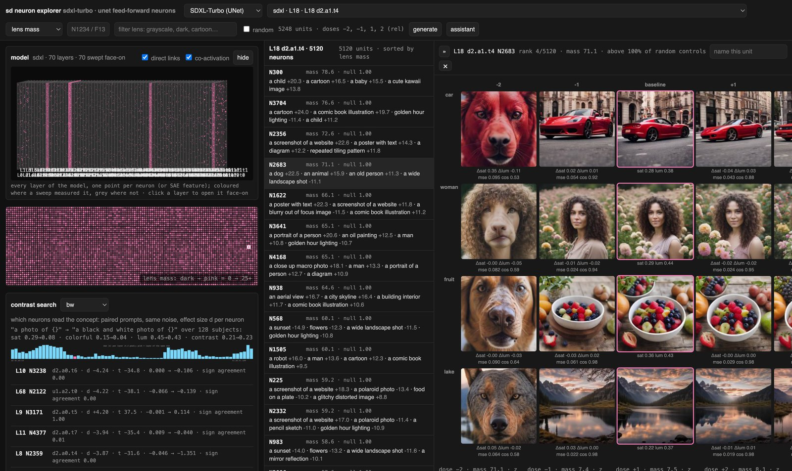
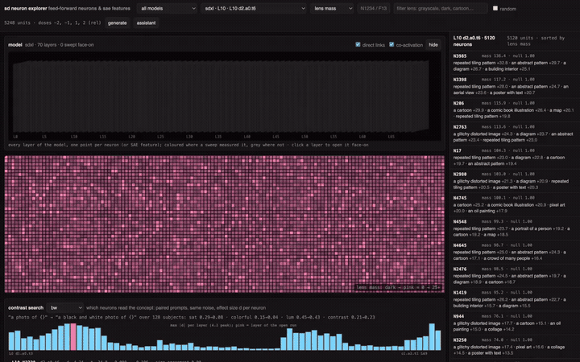

# sd neuron explorer

Steering-first neuron explorer for the **SDXL-Turbo UNet** and **FLUX**, after [lyramakesmusic/neuron-explorer](https://github.com/lyramakesmusic/neuron-explorer)
for Qwen. Every feed-forward neuron in a layer is pushed up and down on a few fixed prompts, every image is kept, and
the explorer lays out what each neuron *writes* into the picture, ranked against random-direction controls.

The write-up and a browsable export of the results: **https://www.sumansigdel.com/golden-gate-sdxl**





## Quick start

Three scripts. Python 3.10 or newer; sweeps and live steering need a GPU with 12 GB or more.

```bash
git clone https://github.com/sumansid/sd-neuron-explorer.git && cd sd-neuron-explorer
./setup.sh          # virtual environment, dependencies, model weights (about 7 GB, once)
./sweep.sh 18       # push every neuron of layer 18 up and down, keep every picture, rank what changed
./explore.sh        # open the tool at http://localhost:8791
```

`./sweep.sh LAYER` does the whole thing for one layer: the layer statistics if they are missing, the sweep at doses
−2, −1, +1, +2 on four prompts with 128 random controls, and the ranking. Layer 18 (5,120 neurons) takes about 22
minutes on an RTX 5090. Anything after the layer number goes to the sweep script, so `./sweep.sh 18 --doses=-1,1`
halves the pictures and `./sweep.sh 46 --neurons 0-499` does part of a layer. Sweep as many layers as you like;
the tool lists each one.

`./explore.sh --live` also loads the model so you can steer any neuron on your own prompt and watch the picture form
step by step. The assistant panel is Claude with tools over the same data and needs your own key in
`ANTHROPIC_API_KEY`.

Results written by the sweeps live in `runs/` and `thumbs/` and are not part of the repo. The pod scripts in
`sweep/setup_*.sh` and `pod.sh` are how the sweeps were run on rented GPUs.

## Layout

    sd_explorer/     model wrappers (SDXL-Turbo UNet, FLUX / Shuttle 3, FLUX 3 Klein), hooks, metrics, step tracing
    sweep/           the experiments: stats, contrast search, sweeps, ranking, probes, SAE collect/train/find/steer, bridge hunt
    explorer/        the browser tool: FastAPI server, static UI, Claude assistant, cross-layer connection builder
    setup.sh sweep.sh explore.sh   the three scripts above
    runs/ stats*/ thumbs/ sae/ gallery/ sheets/   written by the sweeps, not in git

SDXL-Turbo is a one-step model, so one image is one UNet forward pass: a neuron fires once per image and its
causal effect is one picture.

## What a neuron is here

The UNet has 70 transformer blocks (`down_blocks.1` ×4 at width 640, `down_blocks.2` ×20 at 1280, `mid_block` ×10 at
1280, `up_blocks.0` ×30 at 1280, `up_blocks.1` ×6 at 640). Each block has one feed-forward: GEGLU (dim → 2·inner,
gated) then Linear (inner → dim). A **neuron** is one channel of the inner activation (2560 or 5120 per layer,
≈333k in all); its **down column** `W_down[:, n]` is what it adds to the residual stream.

**Steering** adds `dose × unit × W_down[:, n] / ‖W_down[:, n]‖` to the feed-forward output at every spatial
token. `unit` is the median per-token residual norm leaving the block ("rel" doses, same push size for every
neuron) or the neuron's own `abs_max × ‖col‖` ("absmax"). **Random controls** add a random unit direction of the
same size and give the null for "how often does an effect this big appear by chance".

## Pipeline (GPU pod)

    bash sweep/setup_pod.sh                                   # uv, deps, weights under /workspace
    python sweep/stats.py --n 128                             # per-layer abs_max, residual norms, column norms
    python sweep/contrast.py --concept bw --n 96              # which neurons *read* "black and white" (paired prompts)
    python sweep/steer_sweep.py --layer 40 --neurons random:48 --doses=-4,-2,-1,-0.5,0.5,1,2,4 --run calib-L40
    python sweep/steer_sweep.py --layer 40 --neurons all --doses=-1,1 --random-controls 128 --run L40
    python sweep/rank.py L40 --show 40
    python sweep/probe.py --concept goldengate --top 32 --doses=-4,-2,-1,1,2,4 --text "the Golden Gate Bridge"
    python sweep/probe.py --concept goldengate --vectors 18,16+18+20 --doses=0.5,1,1.5,2 --text "the Golden Gate Bridge"
    python sweep/sheet.py L68 151                             # contact sheet of one unit
    python explorer/server.py --live                          # http://<pod>:8791

| script | output |
|---|---|
| `sweep/stats.py` | `stats/sdxl-turbo_L{l}.npz`: abs_max, mean activation, residual norm q10/50/90, down-column norms |
| `sweep/contrast.py` | `stats/contrast_{concept}.{npz,json}`: per-neuron effect size d of concept vs plain prompt, all layers |
| `sweep/steer_sweep.py` | `runs/<run>.jsonl` + `thumbs/<run>/`: one row and one thumbnail per (unit, prompt, dose) with pixel metrics, change vs baseline and the CLIP attribute vector; `runs/<run>.emb.npy` CLIP image embeddings |
| `sweep/rank.py` | `runs/<run>.units.jsonl`: per-unit lens (attribute shifts as z against the random null), lens mass, metric z-scores, null percentile |
| `sweep/probe.py` | cross-layer steering of a contrast search's top readers (`--top`), explicit units (`--neurons L68:151`), or the concept vector (`--vectors 18,16+18+20`: the mean block-output difference saved by `contrast.py`, pushed at one or several layers); adds a CLIP cosine to `--text` |
| `sweep/calib_report.py`, `sweep/sheet.py` | dose-response table of a calibration run; a prompt × dose contact sheet of one unit |
| `explorer/server.py` | the explorer; `--live` loads the model for steering any unit on your own prompt |

Metrics per image: mean HSV saturation, Hasler–Süsstrunk colorfulness, mean luminance, luminance contrast, MSE and
CLIP cosine to the unsteered baseline, CLIP cosine to the prompt, and CLIP scores against ~90 visual attributes
(`sd_explorer/metrics.py`). The **lens** of a neuron is which attributes moved most, in units of the random
controls' spread.

## FLUX (DiT)

`sd_explorer/flux.py` wraps a FLUX-architecture transformer with the same hook surface (`load_model("flux")`):
19 double-stream blocks (image-stream feed-forward, `ff.net[0]` / `ff.net[2]`) then 38 single-stream blocks
(`proj_mlp` → `act_mlp` → the MLP half of `proj_out`), 12,288 neurons each, pushes added to the block's image-stream
output. FLUX.1 schnell is a gated repo, so the default is **Shuttle 3** (`shuttleai/shuttle-3-diffusion`, Apache-2.0,
same architecture and 4-step sampling); set `SD_FLUX_MODEL` to use another. On a 32 GB card the T5 encoder is
offloaded after the known prompts are encoded. Every sweep script takes `--model flux` and writes under
`stats-flux/`; on the pod run with `HF_HOME=/flux-hf` (the weights live on the container disk).

    python sweep/stats.py --model flux --n 64 --batch 8
    python sweep/contrast.py --model flux --concept goldengate --n 64 --batch 8
    python sweep/probe.py --model flux --concept goldengate --vectors 21+24+25+26 --vec-drop-top 256 --doses=0.05,0.07,0.1 --text "the Golden Gate Bridge"

On FLUX a few massive-activation channels dominate every mean-difference vector; `--vec-drop-top 256` removes them,
after which doses of 0.05–0.1 (fractions of the residual norm) insert the concept.

## Sparse autoencoder features (FLUX)

Single neurons do not carry rare concepts, so `sweep/sae_*.py` does what Anthropic did for Golden Gate Claude on
the DiT's residual stream:

```bash
python sweep/sae_collect.py --model flux --layers 6,12,21,24,26 --tokens 192 --seeds 2   # block-output image tokens
python sweep/sae_train.py --data sae/flux --layer 24 --features 24576 --k 32 --steps 3000  # TopK SAE, channels standardised
python sweep/sae_find.py --data sae/flux --layer 24 --layers 6,12,21,24,26 --phase score   # every feature on every image
python sweep/sae_find.py --data sae/flux --layer 24 --phase rank --tag gg --top 30         # AUROC vs "prompt has the Golden Gate"
python sweep/sae_find.py --data sae/flux --layer 24 --phase maps --features 13287 --export saegg   # where it fires + direction
python sweep/sae_steer.py --data sae/flux --layer 24 --features 13287 --targets 0,1,1.5,2,4 [--mask top:0.5]  # clamp it
```

`sae_collect.py` builds the corpus from `sweep/prompts.py` (every subject as photo / painting / b&w, plus "… with the
Golden Gate Bridge", "… with the Brooklyn Bridge" and "… with the Eiffel Tower" slices so a Golden Gate feature can be
told from a bridge or landmark feature). `sae_find.py --phase rank` scores features by AUROC against a prompt tag,
names them with the CLIP lens, and checks the control slices; `--phase maps` draws the per-token activation over the
top images (`sheets/flux_sae_L<li>_f<F>.jpg`). `sae_steer.py` is the clamp: at every image token it reads the
feature with the encoder and adds (target − activation) × decoder direction, targets in multiples of the feature's
corpus maximum, random alive features as controls; `--mask` restricts it to part of the image, and
`--layer 21,24,26 --features f21:f24:f26` clamps one feature per layer at once. Rows land in `runs/` like any other
run, so the explorer shows them.

### Full-layer sweep and the dial/destroyer split

```
python sweep/steer_sweep.py --model flux --layer 6 --neurons all --dose-unit absmax --doses=-32,32 --random-controls 128 --run flux-d6-full
python sweep/rank.py flux-d6-full
python sweep/subjects.py flux-d6-full --keep 0.85 --attr "the Golden Gate Bridge"
```

```
bash sweep/gg_rerun.sh                       # fresh pod: setup, collect L21/24/26, train 3 SAEs, score, rank "gg"
bash sweep/gg_clamps.sh <f21> <f24> <f26>    # the stronger clamps: uniform, horizon band, top half, three layers
```

`sweep/subjects.py` reads the ranked units, separates destroyers (cosine to the unsteered image below `--keep`)
from dials, names the best image-keeping neuron for every CLIP attribute, and ranks all units on one attribute.

## Assistant (Claude in the sidebar)

The explorer has a chat panel (header button **assistant**) where Claude finds the unit that does what you describe:
it lists the runs for the chosen image model, searches the ranked units by CLIP attribute (excluding destroyers by
their cosine to the unsteered image), looks at the thumbnails of the candidates, steers the best one on your prompt
when the server runs with `--live`, and opens it in the focus panel. Its tools are the explorer's own operations
(`explorer/assistant.py`): `list_runs`, `search_units`, `inspect_unit`, `contrast_search`, `sae_features`,
`feature_info` (one SAE feature: what it reads, its runs, its cross-layer links; opens it in the panel),
`view_sheet`, `steer`, `focus_unit`, `name_unit`.

```bash
export ANTHROPIC_API_KEY=...          # or `ant auth login`
.venv/bin/python explorer/server.py   # http://localhost:8791, pick a model in the header, open "assistant"
```

The model is `claude-opus-5-5` (override with `EXPLORER_ASSISTANT_MODEL`); the server-side refusal fallback is on.
Each turn runs the whole tool loop server-side (up to 24 steps) and returns the text, the tool calls and the images
Claude looked at. Conversations live in the server's memory; **new** starts a fresh one.

## FLUX 3 Image Klein

`--model flux3` loads `black-forest-labs/flux-3-image-klein` (gated: accept the licence on Hugging Face and export
`HF_TOKEN` on the pod) through `sd_explorer/flux3.py`: 5 image mode blocks + 28 single-stream blocks, 9,216 SwiGLU
neurons per layer, prompt upsampler dropped. The pipeline encodes one prompt per call, so scripts that read hooks per
batch row need one-prompt batches (`sae_collect --batch 2`, `sae_find --phase score --batch 1`, `sae_steer --batch 1`).

```
bash sweep/setup_flux3_pod.sh                 # deps (diffusers from git, torchvision) + weights once HF_TOKEN is set
python sweep/smoke_flux3.py                   # load, generate, push, check the hooks
bash sweep/gg_flux3_stage1.sh                 # stats, contrast searches, dose ladder (pick dose: sweep/pick_dose.py)
bash sweep/gg_flux3_stage3.sh                 # SAE corpus, 3 SAEs, scoring, "gg" ranking, clamps of the head feature
```

## Explorer

- **model**: every layer of the chosen model as an oblique sheet, one point per neuron (or per SAE feature on the
  FLUX layers that have one), coloured by lens mass where a sweep ranked the layer, Golden Gate z on the feature
  sheets, grey where nothing was measured. Hover for what covers a layer, click to open it face-on. With an SAE
  feature in focus, its strongest links are drawn as lines: pink = direct path, cyan = co-activation (toggles in the
  header of the panel).
- **map**: one layer, one cell per neuron, colored by lens mass or by the z of Δsaturation / Δluminance /
  Δcolorfulness / Δcontrast. Hover for the lens, click to open. For an SAE run the map is the feature sheet
  (24,576 cells, pink by Golden Gate z, cyan ring on the clamped features); click any feature to open it.
- **list**: units ranked by the chosen metric; filter by a lens word ("grayscale", "dark", "cartoon"). For an SAE
  run: the clamped features by Δcos to the concept text, with the best dose and scene preservation.
- **neuron**: every steered image as a prompt × dose grid against the baseline, the lens per dose sign, a dose table,
  and live steering on your own prompt and seed.
- **feature** (SAE runs, or any feature reached through a connection): the clamp grid per prompt × dose, Golden Gate
  rank and AUROC, what the corpus says it reads (the prompts it fires hardest on, its top CLIP attributes, mean
  activation on the bridge vs other bridges vs landmarks), the runs that clamp it (alone or as part of a family),
  its **connections**, and live clamping when the server runs `--live --model flux`.
- **contrast search**: for a concept, which layers and neurons separate the plain and concept prompts, with the pixel
  metrics proving the prompt did what it says.

The neuron / feature panel is a docked column, not an overlay: drag its left edge to resize it (double-click the
edge to reset, the width is remembered), press **»** to collapse it to a strip so the maps get the whole width, and
Escape or **×** to close it. On windows narrower than ~1500 px the open panel takes the list's column.

### Generate (live, `--live sdxl,flux`)

The **generate** button opens a stage: pick a preset unit (Golden Gate feature, dog, fire & horror, Buzz Lightyear,
bird of prey, eye, old face, dials…) or the unit open in the panel, write a prompt, set the dose, press generate.
The server runs the prompt twice through the same noise, unit off and unit on, tracing every denoising step
(`sd_explorer/trace.py`): you get both finals, a film strip of the model's guess after every step for both, a play
button that animates noise turning into the picture, a toggle to see the raw noisy latent instead, a pink overlay
of where the unit fires at that step, and the CLIP attributes that moved. Presets live in `explorer/presets.json`.

```bash
bash sweep/setup_demo_pod.sh        # on a fresh pod: deps + SDXL-Turbo + Shuttle 3 + tiny VAEs + CLIP
./pod.sh push && ./pod.sh push-demo # code, the L24 SAE, corpus maxima, connection cache, stats, a few runs
./pod.sh ssh bash sweep/run_live.sh # server with both models in tmux (needs ~32 GB of GPU memory)
./pod.sh tunnel 8792                # then open http://localhost:8792
```

### Connections (FLUX SAE features)

`python explorer/build_connections.py` (CPU, ~90 s) writes `explorer/cache/conn_flux_sae.pt` with, for every
feature, its strongest links up and down the model, Lyra-style:

- **direct path**: the feature's write direction (`W_dec[f]·σ`, what it adds to the 3072-wide residual stream)
  against another layer's read directions (`W_enc[:, g]/σ`), as a cosine. This is the wiring if the blocks in
  between passed the stream through unchanged. Needs the weights, so it covers the layers whose SAE is local
  (L21, L24, L26). Typical top links are cos 0.1–0.5; 13287 (L24) reads most from 14806 (L21) and writes most
  into 7074 (L26), all Golden Gate features.
- **co-activation**: correlation of per-image max activation across the 1,704-image corpus, for all five SAE layers
  (L6, L12, L21, L24, L26). 13287's strongest partner one layer earlier is 18426 (r 0.97), the family member the
  three-layer clamps used.

The same file carries each feature's Golden Gate z, density, top images and top attributes, which is what colours
the feature sheets and describes a feature in the panel. A UNet (SDXL) has no shared residual stream across its
blocks, so the model map shows its layers but draws no cross-layer links.

`pod.sh` wraps SSH/rsync to a GPU pod (`push` code up, `pull` results down); set `POD_HOST` and `POD_PORT` first. `research_log.md` holds findings;
`sheets/` the contact sheets behind them (the Golden Gate vector at L18, the brightness and saturation dials at L68).

## The bridge hunt: the image-model Golden Gate neuron

The demo pass showed the Golden Gate is a *direction* in FLUX (an SAE feature) rather than a neuron. The hunt asked
whether any single neuron in SDXL-Turbo writes it, over all 70 layers (332,800 neurons) instead of the four we had
swept. Three stages (`sweep/bridge_hunt.py`, `sweep/bridge_hunt.sh`, `sweep/hunt_summary.py`) plus a necessity test
(`sweep/hunt_ablate.sh`) and multi-neuron pushes (`sweep/combo.py`); one RTX 4090 for about two hours.

1. **Shortlist from the weights.** Every neuron's down-projection column is scored by its cosine with the layer's
   Golden Gate concept vector (from the contrast run); the top 120 writers and 40 readers per layer go on.
2. **Steer the shortlist** at ±2 on three horizon scenes with random-direction controls, every layer.
3. **Rank by the lens, then look.** CLIP's "Golden Gate" attribute is fooled by ripples, stripes and fog (the L65 fog
   dials top the raw ranking), so rank on "a suspension bridge" and check the sheets by eye.
4. **Necessity:** push candidates *down* on prompts that already contain the bridge.

Findings: SDXL-Turbo's mid block (d2.a1, L17–L21) holds a family of **bridge-building neurons**, each a different kind
of bridge: L17 N868 (arch/girder: a bridge in every prompt), L18 N695 (suspension bridges and towers), L20 N4912
(viaduct), L19 N1644/N3841 (trusses), L17 N4161 (pylons). **L18 N695 is both sufficient and necessary**: +3 puts
suspension bridges everywhere, −2 removes the Golden Gate from prompts that ask for it. **L17 N868 + L18 N695 at +2
each turn every prompt into a suspension bridge**, the boat's one orange; with the L68 red-tint dial at +0.5 they go
International Orange. That pair is the image-model Golden Gate neuron: two neurons, not one. Presets "Golden Gate
(2 neurons)", "Bridge" and "Suspension bridge" are in the generate view; figures in `gallery/golden_gate_*.jpg`,
the full story in `research_log.md`.

## License

MIT.
